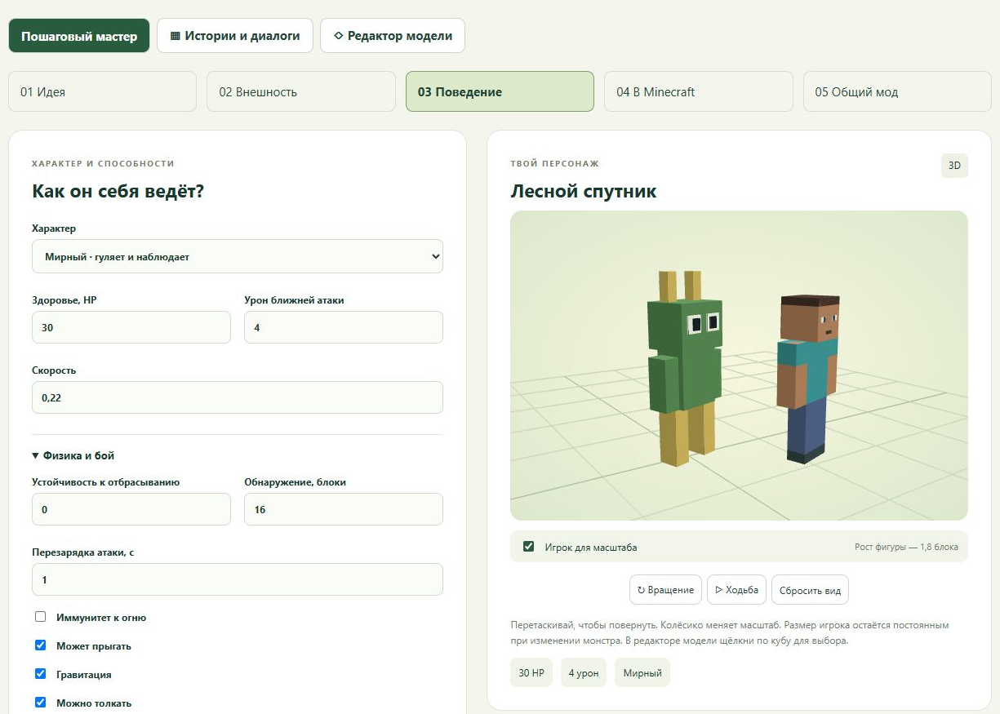

# Мастерская монстров для Minecraft Bedrock

Локальный редактор: рисунок и описание → кубическая модель → поведение, истории и торговля → индивидуальный или общий `.mcaddon`. Интерфейс на русском языке. Целевая техническая версия движка — **1.26.60** (Bedrock 26.60).

## Запуск

Нужен **Python 3.10+**. Для обычной работы не нужны Node.js, Python-библиотеки или сборка интерфейса.

На Windows откройте **«Запустить мастерскую.cmd»**. Либо выполните из корня проекта:

```sh
python app/server.py
```

Откроется [http://127.0.0.1:8766](http://127.0.0.1:8766). Сервер работает, пока запущен процесс Python; остановка — Ctrl+C. Для запуска без открытия браузера используйте `--no-browser`.

## Создание персонажа

1. **Идея:** имя, описание, рисунок и уникальный `namespace:id`.
2. **Внешность:** встроенный шаблон, импорт из Blockbench или генерация через установленный Codex CLI. Кости, кубы и UV редактируются отдельно; рядом с монстром отображается фигура игрока для масштаба.
3. **Поведение:** здоровье, бой, физика, биомы, ограничения появления, добыча, таймеры и торговля. Во вкладке «Истории и диалоги» доступны 20 блоков и семь примеров.
4. **В Minecraft:** сборка одного персонажа в `.mcaddon`.
5. **Общий мод:** объединение 2–12 сохранённых персонажей или индивидуальных экспортов этой мастерской, проверка ID и ссылок, общий предел численности и один BP/RP.

В тестовом мире активируйте пакет поведения и ресурсов, затем используйте яйцо призыва или показанную команду `/summon`. При переходе к общей сборке выключите индивидуальные пакеты с теми же ID.



## Данные и приватность

Проекты, рисунки, архивы и журналы хранятся **отдельно от исходного кода**:

- Windows: `%LOCALAPPDATA%/MinecraftMonsterWorkshop`;
- Linux/macOS: `$XDG_DATA_HOME/MinecraftMonsterWorkshop` или `~/.local/share/MinecraftMonsterWorkshop`.

Другую папку можно задать через `MONSTER_WORKSHOP_DATA_DIR` или `--data-dir`:

```sh
python app/server.py --data-dir "../workshop-data"
```

Обычное редактирование и экспорт работают локально. Генерация модели запускается только после отдельного согласия: рисунок, описание и истории выбранного проекта передаются через Codex CLI. Данные входа Codex не копируются в проект. Унаследованные `OPENAI_API_KEY` и `CODEX_API_KEY` удаляются из окружения запуска генерации. Подробности — [безопасность](docs/SECURITY.md).

## Документация

- [Pipeline и использование](docs/PIPELINE.md).
- [Модель и параметры Bedrock](docs/MODELS.md).
- [Истории и диалоги: 20 блоков](docs/STORIES.md).
- [Добыча, торговля и ограничения появления](docs/BEHAVIOR.md).
- [Объединение модов](docs/BUNDLES.md).
- [Архитектура и API](docs/ARCHITECTURE.md).
- [Разработка и проверки](docs/DEVELOPMENT.md).

## Проверки

Python-тесты используют только стандартную библиотеку. Для JavaScript-тестов нужен **Node.js 22+**:

```sh
python -B -m unittest discover -s app -v
node app/check.mjs
python -B tools/check_public.py
```

Генерация, HTTP и игровые API проверяются локальными подменами; тесты не вызывают Codex и не расходуют его лимиты. Дополнительные проверки стиля и секретов описаны в инструкции разработчика.

## Границы

Редактор поддерживает кубическую Bedrock Geometry 1.12.0 и PNG. Полёт, снаряды, произвольные анимации и собственные звуковые файлы пока не редактируются. Сборщик объединяет экспорты этой мастерской, а не произвольные сторонние моды. Автоматические проверки и работа интерфейса подтверждены; проверка готового дополнения в Minecraft и Realms остаётся необходимым отдельным этапом.

## Лицензия

Код и собственная документация — [MIT](LICENSE). Three.js поставляется со своей [MIT-лицензией](app/web/vendor/THREE-LICENSE.txt); см. [сторонние материалы](THIRD_PARTY_NOTICES.md). Чужие рисунки, модели, видео и исследовательский атлас не входят в репозиторий. Minecraft — независимая от этого проекта игра; принадлежность к Mojang/Microsoft не заявляется.
