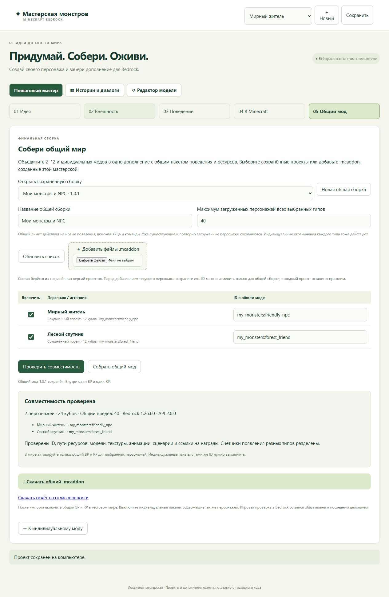

# Общий мод

На шаге «05 Общий мод» объединяются 2–12 сохранённых проектов и/или индивидуальных `.mcaddon` этой мастерской. Итог содержит один BP, один RP, один входной script-модуль и отчёт о согласованности.

1. Сохраните исходных персонажей. Для файловых источников достаточно готового индивидуального экспорта.
2. Выберите состав, имя и общий лимит загруженных персонажей: по умолчанию 40, диапазон 1–200.
3. Назначьте уникальные ID. Переименование относится только к общей сборке; исходники не меняются.
4. Нажмите «Проверить совместимость». Исправьте ошибки и повторите проверку.
5. Нажмите «Собрать общий мод». Состав сохранится в списке общих сборок, архив и JSON-отчёт — в каталоге данных приложения.

Проверяются определения и ссылки на сущности, модели, текстуры, анимации, render controllers, переводы, добычу и награды. Правила появления получают разные пути. У каждого типа своя конфигурация сценариев и свой счётчик частоты. Весь состав дополнительно ограничен общим пределом новых появлений во всех трёх измерениях. Старые/загруженные существа не удаляются, поэтому уже переполненный мир не уменьшается принудительно.

Версия движка берётся по самому требовательному источнику, не ниже 1.26.60. Для NPC используется стабильный серверный API 2.4.0, иначе 2.0.0. Общая пара получает собственные UUID; при обновлении той же сборки UUID сохраняются, версия увеличивается. Индивидуальные версии не изменяются.

Состав хранит ссылки на сохранённые проекты. Следующая проверка берёт их актуальные версии. Загруженный архив остаётся локальной копией: для обновления добавьте новый файл вместо старого. Если исходник изменился после проверки, сборщик требует повторной проверки.

Поддерживается формат индивидуального экспорта этой мастерской. Чужие произвольные add-ons, Marketplace, Java JAR, пользовательские скрипты и неизвестные группы событий не объединяются. Исполняемый код архивов при импорте не запускается; известный runtime создаётся из текущего кода приложения. Общую сборку нельзя добавить как индивидуального персонажа.

Ограничения: 12 МБ на архив, 64 МБ распакованного содержимого источника, 16 МБ на файл и 128 МБ на итоговую сборку. ZIP не извлекается в файловую систему; опасные, неканонические и повторяющиеся пути отклоняются.

При установке включите общие BP/RP и выключите индивидуальные пакеты с теми же ID. Проверьте копию мира: смена пакета или ID автоматически не переносит владельцев, таймеры, состояния торговли и уже размещённых существ. Истории разных NPC остаются независимыми. [Правила manifest](https://learn.microsoft.com/en-us/minecraft/creator/reference/content/addonsreference/packmanifest?view=minecraft-bedrock-stable).

